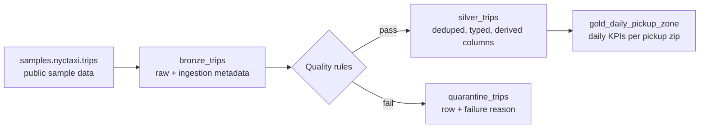

# Architecture

## Layers

| Layer | Table | Purpose |
|---|---|---|
| Bronze | `bronze_trips` | Raw landing, adds `_ingested_at` and `_source` for lineage |
| Silver | `silver_trips` | Rows that passed quality rules, deduplicated, with `trip_minutes` and `pickup_date` |
| Quarantine | `quarantine_trips` | Rows that failed a rule, kept with `_dq_failure` so nothing is silently dropped |
| Gold | `gold_daily_pickup_zone` | Trip count, total/avg fare, avg distance and duration per day and zip |

## Design decisions

> Replace these with your own reasoning. Interviewers will ask about them.

1. **Pure transform functions, thin job wrapper.** All logic lives in `transforms.py` with no I/O, so it is unit-testable on a laptop. `jobs.py` only reads and writes tables.
2. **Quarantine instead of drop.** Failed rows are kept with a reason, which makes data quality auditable and gives a rejection-rate metric.
3. **Overwrite writes for the demo.** Simple and idempotent. For production volumes, switch silver and gold to incremental `MERGE` keyed on a trip identifier or a partition overwrite by `pickup_date`.
4. **Asset Bundles for deployment.** One `databricks.yml` with dev and prod targets keeps environments reproducible and deployable from CI.
5. **Serverless job compute.** No cluster to size or tune for a workload this small.

## Quality rules

Defined in `with_quality_flags`: null timestamps, non-positive or over 6 hour duration, negative distance, fare outside 0 to 500.
